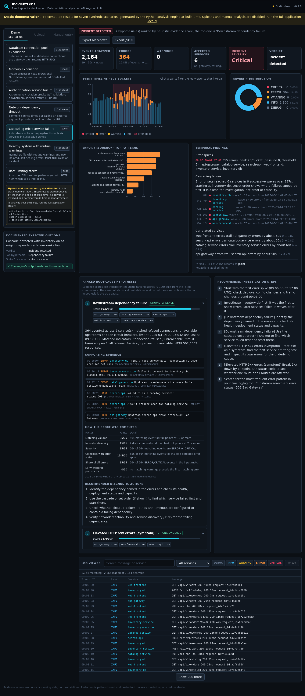
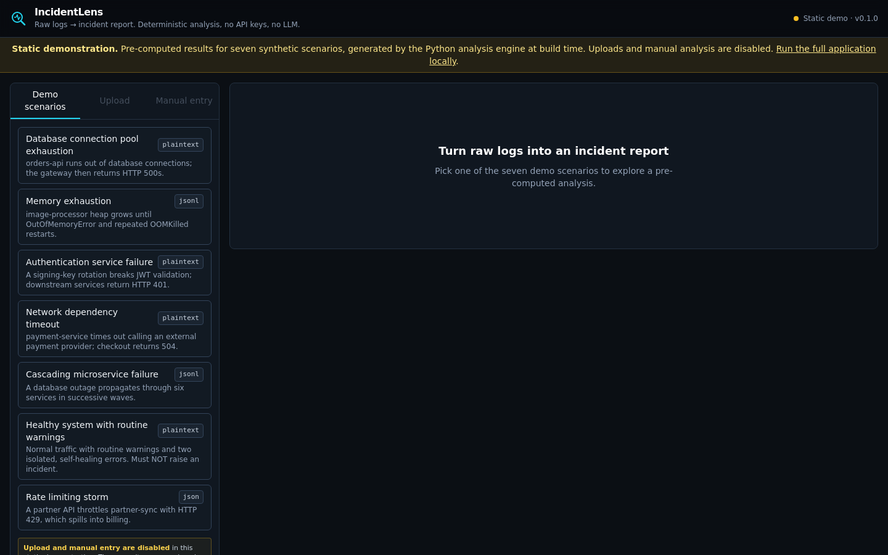
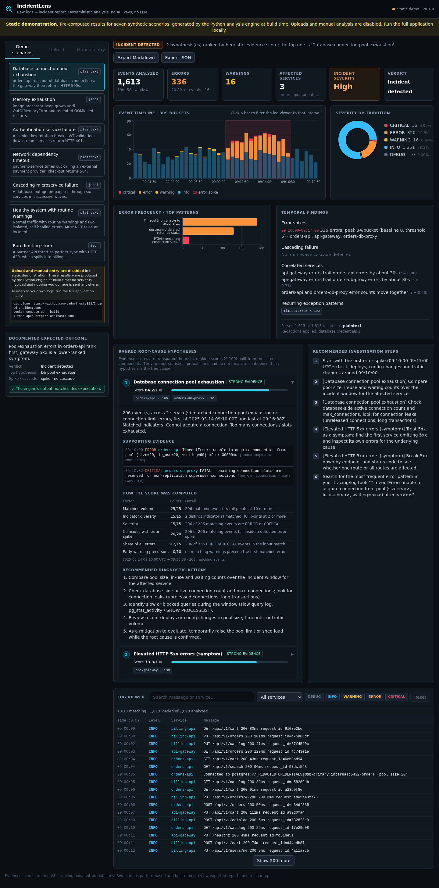
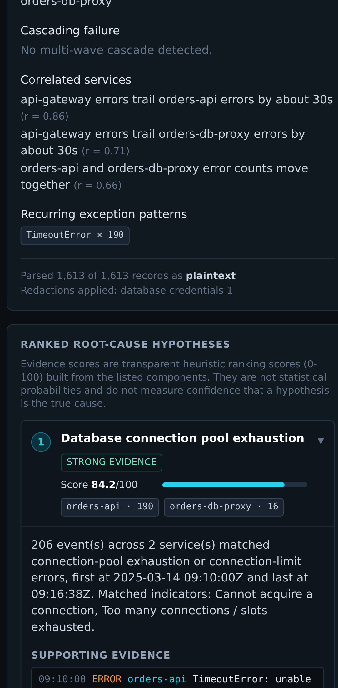
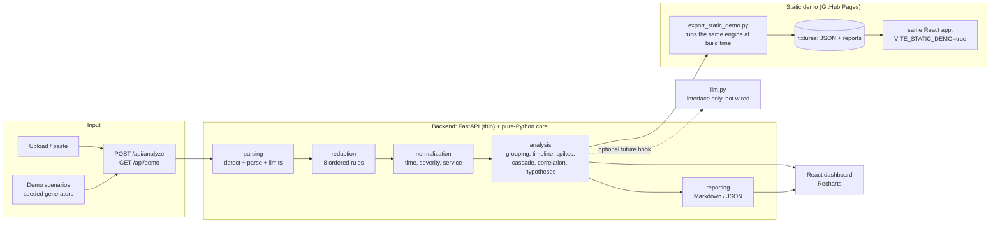

# IncidentLens

[](https://github.com/badmrfrosty313/IncidentLens/actions/workflows/ci.yml)


**Turn raw application logs into an incident report**: severity, an event timeline, ranked root-cause hypotheses with
supporting evidence and a transparent score, and concrete next diagnostic steps. Paste or drop in plaintext, JSON or JSONL logs.

- **Live demo (static, no backend):** <https://badmrfrosty313.github.io/IncidentLens/> *(published by the Pages workflow once the
  owner merges to `main` and enables GitHub Pages; until then, build it locally with the commands below).*
- **Deterministic by design.** The analysis is rule-based and explainable. **No LLM is called, no API keys are needed, nothing is
  stored.** An extension point exists for a possible future, optional LLM layer (see [below](#deterministic-analysis-vs-a-possible-future-llm-layer)).



<table>
<tr>
<td width="50%"></td>
<td width="50%"></td>
</tr>
<tr>
<td align="center"><sub>Scenario picker and static-demo notice</sub></td>
<td align="center"><sub>Hypotheses, evidence and score breakdown (full page)</sub></td>
</tr>
<tr>
<td colspan="2" align="center"> </td>
</tr>
</table>

*Screenshots are captured from the running application by the Playwright suite in CI.*

## Quick start

Requirements: Python 3.11+, Node 20+ (or just Docker).

```bash
# Full application with Docker: UI + API at http://localhost:8080
docker compose up --build
```

```bash
# Local development
cd backend && python -m venv .venv && source .venv/bin/activate    # Windows: .venv\Scripts\activate
pip install -r requirements-dev.txt
uvicorn app.main:app --reload                                      # API on :8000, OpenAPI docs at /docs

cd frontend && npm ci && npm run dev                               # UI on :5173, proxies /api to :8000
```

Open the UI and pick a demo scenario, or upload a file from [`data/demo/`](data/demo).

```bash
# Build and preview the static demonstration locally (what GitHub Pages serves)
cd frontend && npm ci
npm run demo:data                                  # the Python engine writes public/demo-data/*
VITE_BASE=/IncidentLens/ npm run build:demo
VITE_BASE=/IncidentLens/ npm run preview           # http://localhost:4173/IncidentLens/
```

## Features

| Area | What it does |
| --- | --- |
| Ingestion | Drag-and-drop upload or manual entry. Auto-detects **plaintext, JSON array, JSONL**. Normalizes timestamps (ISO-8601, epoch s/ms/µs, naive = UTC), severity (names, syslog and pino numeric levels), service names and messages. Malformed records are counted and skipped, never fatal. Size and record-count limits are enforced. |
| Redaction | API keys, auth tokens, passwords, JWTs, emails, database-URL credentials, `Authorization` headers and PEM private keys are redacted **before** normalization and analysis, using best-effort pattern matching (see [Security design](#security-design-and-limits)). |
| Analysis | Error grouping by message signature, severity distribution, affected services, error-spike detection, cascading-failure detection (ordered onset waves), per-service temporal correlation with lag, recurring exception patterns. |
| Hypotheses | Database pool exhaustion, network timeouts, memory exhaustion, authentication failures, dependency failures, rate limiting, HTTP 5xx. Each has evidence, a **heuristic score (not a probability)** with a per-component breakdown, affected services and diagnostic actions. Returns *insufficient evidence* / *no incident* when appropriate. |
| Dashboard | Dark, responsive. Clickable stacked timeline (filters the log viewer), severity and error-frequency charts, ranked hypotheses, findings, filterable/searchable log viewer, investigation steps. |
| Demo data | 7 synthetic scenarios with documented, machine-checked expected outcomes: [docs/DEMO_SCENARIOS.md](docs/DEMO_SCENARIOS.md). |
| Reports | Export Markdown or JSON. Log-derived text is neutralized in Markdown (including table cells). |
| Static demo | The same UI as a pre-rendered site: fixtures generated by the Python engine at build time, upload/manual entry disabled, no API calls. |

## Key engineering points

- **Clean pipeline, no framework in the core:** parse → redact → normalize → analyze → report are separate, individually tested
  modules; FastAPI is a thin layer on top. The analysis core is the standard library plus pydantic.
- **Explainable scoring:** every hypothesis shows the exact factors and points behind its 0-100 heuristic score, and the product
  says plainly that it is not a probability. A healthy-system scenario must produce *no incident* (false-positive guard).
- **Untrusted input handled as such:** bounded, anchored regexes (with adversarial-input tests), size/record limits that reject rather than
  truncate, sanitized error responses, Markdown neutralization, text-node-only rendering in the UI.
- **Reproducible demo:** seeded scenarios with expected outcomes checked by code; static-demo fixtures are generated from the engine in CI
  (never hand-written) and a test asserts they equal what the live API serves.
- **Verified in a real browser:** a Playwright suite runs against the static build on desktop and mobile viewports (charts render, filters
  work, reports download, no backend requests, no console errors).
- **Reviewed and hardened:** two rounds of independent review produced regression tests for each finding (see
  [docs/SECURITY.md](docs/SECURITY.md)).

## Architecture



Details: [docs/ARCHITECTURE.md](docs/ARCHITECTURE.md).

## Verified quality

Counts below are from the latest successful GitHub Actions run on the PR branch, not estimates.

| Check | Result |
| --- | --- |
| Backend tests (pytest, Python 3.11 and 3.13) | 227 passed |
| Frontend unit/component tests (Vitest) | 57 passed |
| Browser smoke tests (Playwright, Chromium: 7 tests x desktop and mobile) | 14 passed |
| Demo scenarios vs documented expected outcomes | 7 / 7 |
| TypeScript (strict) + production builds (full-stack and static) | pass |
| Docker Compose build + HTTP smoke test of the running stack | pass |

## Benchmarks (measured)

`python backend/scripts/benchmark.py`: in-process pipeline (parse, redact, normalize, analyze, report), synthetic logs, median of 3 runs.
Measured on a 2-vCPU Linux x86_64 sandbox, CPython 3.13.18 (not on CI hardware, not including HTTP or browser rendering).
Full table and per-stage timings: [docs/BENCHMARKS.md](docs/BENCHMARKS.md).

| Events | Input (MiB) | Runs | parse (s) | redact (s) | normalize (s) | analyze (s) | report (s) | Total (s) | Events/s | Peak RSS (MiB) |
| ---: | ---: | ---: | ---: | ---: | ---: | ---: | ---: | ---: | ---: | ---: |
| 1,000 | 0.10 | 3 | 0.002 | 0.003 | 0.005 | 0.015 | 0.001 | 0.027 | 37,473 | 31 |
| 10,000 | 0.96 | 3 | 0.031 | 0.037 | 0.062 | 0.124 | 0.001 | 0.259 | 38,594 | 48 |
| 100,000 | 9.61 | 3 | 0.300 | 0.337 | 0.863 | 1.382 | 0.002 | 2.950 | 33,894 | 224 |

Run-to-run variance on a shared sandbox is noticeable (an earlier run of the same code measured about 40,500 events/s at 100,000 events); treat the figures as indicative.

## Security design and limits

All uploaded content is untrusted data. Highlights (full threat model in [docs/SECURITY.md](docs/SECURITY.md)):

- Nothing is persisted and the analysis makes no network calls. The full application has **no authentication**: do not expose it to the
  public internet as-is. The public demo is a static site; the FastAPI backend is never exposed.
- Redaction is **best-effort pattern matching, not a guarantee.** It covers common secret shapes (including escaped, quoted and
  unterminated values and PEM blocks) but cannot detect secrets that have no recognizable shape or key name, and it errs toward
  over-redaction. Review exported reports before sharing.
- Limits reject oversized input (413, including chunked uploads) rather than truncating; validation errors never echo submitted values.
- Heuristic scores rank hypotheses; they are not probabilities, and the rules were tuned on synthetic scenarios only.

More: [docs/LIMITATIONS.md](docs/LIMITATIONS.md).

## Deterministic analysis vs a possible future LLM layer

**Today:** every result comes from fixed rules and arithmetic over the redacted events. The same input always produces the same output,
no model is called, and the repository contains no API keys or provider SDKs.

**Possible future (not implemented):** `backend/app/llm.py` defines an interface for an *optional* enrichment step (for example, drafting
narrative text from the already-redacted, already-scored findings). It is a hook only: nothing in the pipeline calls a model, and any
future integration would need its own privacy review because it would send data to a third party.

## API

Interactive documentation is generated by FastAPI at `/docs` (Swagger UI) and `/openapi.json`.

| Method | Path | Description |
| --- | --- | --- |
| GET | `/api/health` | Liveness: `{"status":"ok","version":"…"}` |
| POST | `/api/analyze` | Body `{"content": "<logs>", "format": "auto\|plaintext\|json\|jsonl"}` → full analysis. `413` if over the size/record limits (also for chunked uploads), `422` for empty/invalid input; validation errors list only `loc`/`type` and never echo submitted values. |
| GET | `/api/demo` | List scenarios with their documented expected outcomes |
| GET | `/api/demo/{scenario}` | Analyze a scenario → `{scenario, analysis}`; `404` if unknown |
| POST | `/api/report?format=markdown\|json` | Analyze and return a downloadable report (supports the UI export buttons) |
| GET | `/api/demo/{scenario}/report?format=…` | Report for a demo scenario |

```bash
curl -s localhost:8000/api/analyze -H 'content-type: application/json' \
  -d '{"content": "2025-03-14T09:00:00Z ERROR [orders-api] connection pool exhausted"}' | jq .verdict
```

### Supported input shapes

- **Plaintext:** `2025-03-14T09:00:00Z ERROR [svc] message`, `2025-03-14 09:00:00,123 WARN svc - message`,
  `[2025-03-14T09:00:00Z] [ERROR] svc: message`, `<ts> svc ERROR message`. Indented / `at …` / `Traceback` lines fold into the previous record.
- **JSONL / JSON array:** keys are matched case-insensitively from common aliases (`timestamp|@timestamp|time|ts`,
  `level|severity|lvl`, `service|app|component|name`, `message|msg|text`), plus `error`/`exception`/`stack` and `status` fields.

### Input limits (override with environment variables)

| Limit | Default | Variable |
| --- | --- | --- |
| Decoded input size | 20 MiB | `INCIDENTLENS_MAX_INPUT_BYTES` |
| Records (parsed + malformed) | 100,000 (rejected, never truncated) | `INCIDENTLENS_MAX_EVENTS` |
| Line length (plaintext clipped, JSON rejected) | 16,384 chars | `INCIDENTLENS_MAX_LINE_CHARS` |
| Stored message length | 2,000 chars | `INCIDENTLENS_MAX_MESSAGE_CHARS` |
| Events returned to the log viewer | 5,000 (warnings/errors prioritized) | `INCIDENTLENS_MAX_RETURNED_EVENTS` |

## Testing

```bash
cd backend  && python -m pytest                      # unit, scenario, limits, reporting, security regressions, API tests
cd backend  && python scripts/evaluate_demos.py      # each scenario vs its documented expected outcome
cd frontend && npm test                              # Vitest + Testing Library
cd frontend && npm run build                         # type-check + production build
cd frontend && npm run demo:data && npm run build:demo && npx playwright install chromium && npm run e2e   # browser smoke tests
docker compose up -d --build && scripts/smoke.sh     # HTTP smoke test of the containerised stack
```

CI ([.github/workflows/ci.yml](.github/workflows/ci.yml)) runs all of the above on every push and pull request. The Pages workflow
([.github/workflows/pages.yml](.github/workflows/pages.yml)) deploys the static demo only after CI succeeds on `main`.

## Project layout

```
backend/app/        parsing -> redaction -> normalization -> analysis/ -> reporting (+ pipeline.py, main.py, demo/)
backend/tests/      pytest suite
backend/scripts/    benchmark, demo-data export, static-demo export, scenario evaluation
frontend/src/       React + TypeScript + Tailwind + Recharts (components/, lib/, types/)
frontend/e2e/       Playwright browser smoke tests
data/demo/          exported synthetic datasets (upload these in the UI)
docs/               ARCHITECTURE, SECURITY, LIMITATIONS, DEMO_SCENARIOS, BENCHMARKS, release notes, screenshots
```

## Dependencies

Backend: `fastapi`, `pydantic`, `uvicorn` (tests: `pytest`, `httpx`). Frontend: `react`, `react-dom`, `recharts`
(dev: Vite, TypeScript, Tailwind CSS, Vitest, Testing Library, Playwright). Dependency audit status: [docs/SECURITY.md](docs/SECURITY.md).

## License

No license has been chosen yet; until the repository owner adds one, all rights are reserved.

Release notes: [docs/RELEASE_NOTES_v0.1.0.md](docs/RELEASE_NOTES_v0.1.0.md).
